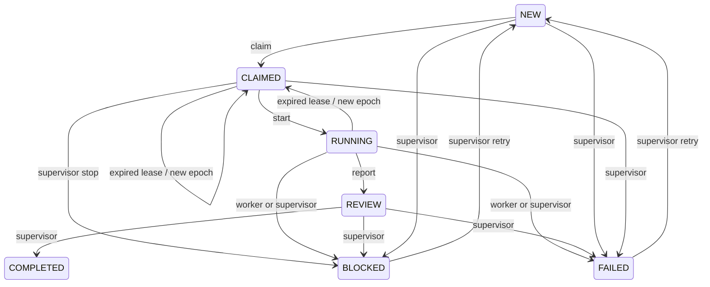

# مدیر مأموریت پاکشو — نمونه اولیه مستقل

شناسه مأموریت ساخت: `PAKSHO-AGENT-MANAGER-ARCH-001`؛ عامل: `CODEX-MANAGER`.
مرجع دستور: [نظر 6123734979 در PR۹](https://github.com/antigravity1344-code/my-mobile-app/pull/9#issuecomment-6123734979).
این ابزار فقط در مسیر خودش است؛ به اپ، سرور، پایگاه داده عملیاتی و CI موجود متصل نیست.

## اجرا

Node.js 24 یا جدیدتر؛ کتابخانه‌های داخلی `node:sqlite` و `node:test` کافی‌اند. نصب بسته، API key، GitHub token یا سرویس خارجی لازم نیست.

از ریشه مخزن:

```bash
cd tools/pakshoo-agent-manager
node --test test/*.test.mjs
node demo.mjs
```

نمونه نمایشی در یک پوشه تازه در مسیر موقت، DB مستقل می‌سازد و مسیر آن را چاپ می‌کند. فقط `DEMO-OFFLINE-001` را اجرا می‌کند؛ مأموریت‌های واقعی یا قبلی را وارد/تصاحب نمی‌کند. TTL نمایشی ۶۰ ثانیه، سیاست عملیاتی نیست. DB نمایشی برای بررسی باقی می‌ماند؛ در Git ثبت نشود.

CLI تک‌فرمانی با ورودی JSON از stdin و خروجی JSON:

```bash
node cli.mjs /tmp/pakshoo-demo.sqlite examples/supervisors.json < examples/register.json
```

PowerShell، با مسیر تازه و پوشه موجود:

```powershell
Get-Content -Raw examples/register.json | node cli.mjs "$env:TEMP\pakshoo-demo.sqlite" examples/supervisors.json
```

`supervisors.json` شناسه‌های مورد اعتماد **در همین فرایند محلی** را تعیین می‌کند؛ نمونه آن هویت ناظر واقعی نیست. هر ورودی فقط یک فرمان است. DB و فایل تنظیمات را با دسترسی سیستم‌عامل محدود نگه دارید. ابزار سرور HTTP یا درگاه عمومی ندارد.

## قرارداد فرمان‌ها

همه تغییرها `commandId` غیرتکراری می‌خواهند. retry همان فرمان باید دقیقاً همان JSON معنایی را بفرستد؛ ترتیب کلیدهای شیء اهمیتی ندارد. تکرار موفق نتیجه قبلی را با `replayed:true` برمی‌گرداند و رخداد/اثر تازه نمی‌سازد. کلید یکسان با محتوای متفاوت `COMMAND_ID_CONFLICT` می‌دهد. خطاها ثبت فرمان موفق نمی‌شوند و قابلیت retry دارند.

| نوع | ورودی اصلی | شرط |
|---|---|---|
| `register` | actor، ownerApproved=true، spec | actor در supervisors؛ تعریف معتبر و ثابت |
| `claim` | taskId، role، agentId، runId، ttlMs | NEW یا CLAIMED/RUNNING منقضی؛ وابستگی کامل؛ منبع آزاد |
| `start` | taskId، agentId، runId، epoch | مالک زنده در CLAIMED |
| `heartbeat` | همان مالک + ttlMs | مالک زنده؛ مهلت کوتاه نمی‌شود |
| `finish` | همان مالک + status + report | RUNNING؛ status فقط REVIEW/BLOCKED/FAILED |
| `decide` | taskId، actor، expectedRevision، status، reason | ناظر؛ revision فعلی؛ COMPLETED فقط از REVIEW |
| `retry` | taskId، actor، expectedRevision، reason | ناظر؛ فقط BLOCKED/FAILED → NEW |
| `report-receipt` | actor، reportId، receipt | ناظر؛ receipt فقط `simulated:...` |
| `get` | taskId | خواندن snapshot؛ commandId لازم نیست |
| `events` | taskId، limit اختیاری، cursor اختیاری | صفحهٔ محدود تاریخچه |
| `pending-reports` | limit اختیاری، cursor اختیاری | صفحهٔ محدود outbox تحویل‌نشده |

نمونه claim بعد از register مثال CLI:

```json
{
  "commandId": "demo-claim-001",
  "type": "claim",
  "taskId": "DEMO-CLI-001",
  "role": "MAIN_CODEX",
  "agentId": "DEMO-AGENT",
  "runId": "DEMO-RUN-001",
  "ttlMs": 60000
}
```

`spec` شامل taskId، repository، sourceCommentId، baseSha، role، dependencies، resources و actions است. فیلد ناشناخته رد می‌شود. شناسه و SHA فقط **ساختار** را اعتبارسنجی می‌کنند؛ وجود یا اصالت دستور در GitHub را تأیید نمی‌کنند. ثبت تعریف و تأیید مالک، مسئولیت درگاه قابل اعتماد آینده است. actions فقط READ_REPO/WRITE_ISOLATED_BRANCH/REPORT است. ابزار هیچ فرمان shell یا عملیات GitHub از آن‌ها اجرا نمی‌کند.

برای `finish` حداقل `report.summary` غیرخالی لازم است. شواهد، نتایج آزمون، محدودیت‌ها و لینک‌ها را در همین شیء می‌توان ثبت کرد. سقف ثابت گزارش دقیقاً **32768 بایت UTF-8 از کل JSON canonical سریال‌شده** است؛ کلیدها، نشانه‌گذاری و escapeها نیز شمرده می‌شوند. اندازهٔ 32768 پذیرفته و 32769 با `REPORT_TOO_LARGE` رد می‌شود. اطلاعات محرمانه یا مقدار credential را در تعریف، گزارش یا DB نگذارید. actor/agent/run/epoch شناسه هستند، اعتبارنامه نیستند.

طرح اولیهٔ F-02/F-03 در [SECURITY_PROPOSAL.fa.md](SECURITY_PROPOSAL.fa.md) محفوظ است. وضعیت پیاده‌سازی مرحلهٔ چهارم، قرارداد ورودی/صفحه‌بندی و آداپتور اعتماد آفلاین در [SECURITY_004.fa.md](SECURITY_004.fa.md) آمده است. احراز هویت واقعی همچنان ساخته نشده است.

از مرحلهٔ چهارم، stdin و تنظیمات هرکدام پیش از parse حداکثر 262144 بایت UTF-8 و ۵۰۰۰ میلی‌ثانیه مهلت خواندن دارند. عمق پیش از parse حداکثر 32 است. نمایش canonical نیز سقف 262144 بایت دارد و مجموع عضوها/عنصرها حداکثر 10000 است. فیلد ناشناختهٔ فرمان رد می‌شود. این کنترل‌ها در CLI احراز هویت ایجاد نمی‌کنند.

**تغییر قرارداد CLI:** خروجی `events` و `pending-reports` اکنون `{items, snapshot, nextCursor}` است، نه آرایه. اندازهٔ پیش‌فرض صفحه 100، حداکثر 500 و سقف پاسخ شامل newline برابر 1048576 بایت UTF-8 است. `nextCursor` را بدون تغییر در درخواست بعد بفرستید تا null شود؛ برای polling تازه cursor را حذف کنید. متدهای قدیمی آرایه‌ای در API محلی فقط یک صفحه را برمی‌گردانند و اگر ادامه لازم باشد `PAGINATION_REQUIRED` می‌دهند؛ از `eventsPage` و `pendingReportsPage` استفاده کنید. هیچ تاریخچه یا outbox حذف نمی‌شود.

## وضعیت، قفل و بازیابی



`BEGIN IMMEDIATE` یک نویسنده را در SQLite سری می‌کند. وضعیت، command receipt، رخداد و outbox در یک تراکنش‌اند. مرجع معتبر، همین DB مستقل روی **یک میزبان** است؛ نوشتن نظر، label و status در GitHub قفل هسته نیست. هم‌زمانی دو فرایند روی همان فایل آزمایش شده است؛ این تضمین چند runner با DBهای جدا یا filesystem شبکه‌ای نیست.

مالک قفل `(agentId, runId, epoch)` است. نسل در هر claim افزایش می‌یابد؛ پس عامل قبلی حتی با همان شناسه پس از بازیابی حق نوشتن ندارد. انقضا در `lease_until <= now` است. heartbeat فقط مالک زنده را تمدید می‌کند. بازپخش receipt قدیمی **snapshot تاریخی** است و تمدید یا مجوز تازه نمی‌دهد؛ پیش از کار وضعیت جاری را بخوانید و همه تغییرها را با lease جاری به هسته بفرستید.

منابع نام‌دار را مشترک و دقیق تعیین کنید؛ دو مأموریت با همان نام منبع نمی‌توانند مالک زنده هم‌زمان شوند. منابع expired قابل تصاحب‌اند؛ عامل قدیمی دیگر نمی‌تواند نتیجه ثبت کند. REVIEW منبع را تا تصمیم ناظر نگه می‌دارد و خودکار بازاجرا نمی‌شود. BLOCKED/FAILED/COMPLETED منابع را آزاد می‌کنند. بدون اعلان resource مشترک، تعارض بیرون هسته قابل تشخیص نیست. نام‌گذاری ناهماهنگ معادل قفل صحیح نیست.

dependency فقط هنگام ثبت و به task موجود پذیرفته می‌شود؛ تعریف بعداً تغییر نمی‌کند، بنابراین چرخه از طریق API ساخته نمی‌شود. claim تنها زمانی مجاز است که همه dependencyها COMPLETED باشند. تغییر محتوای مأموریت نیاز به task-id جدید دارد؛ تکمیل قدیمی خودکار بازگشایی نمی‌شود.

زمان بعد از گرفتن قفل DB خوانده می‌شود و با بیشترین زمان مشاهده‌شده مقایسه می‌شود. مشاهده زمان حتی در فرمان ردشده باقی می‌ماند؛ تغییرهای مأموریت با savepoint rollback می‌شوند. عقب‌رفتن ساعت lease منقضی را زنده نمی‌کند؛ جلوپریدن ساعت می‌تواند باعث انقضای زودرس شود. ساعت میزبان و امنیت/سلامت فایل DB مورد اعتمادند؛ HA و ساعت توزیع‌شده ساخته نشده است.

قطع قبل commit، تغییر جزئی را rollback می‌کند. قطع پس از commit، claim و lease را حفظ می‌کند. مالک جایگزین بعد از انقضا با command-id جدید claim می‌کند؛ مأموریت COMPLETED با replay یا claim دوباره اجرا نمی‌شود. fencing فقط **نوشتن در هسته** را کنترل می‌کند؛ عامل قدیمی خارج هسته ممکن است هنوز در حال اجرا باشد. مجری واقعی آینده باید پیش از effects خارجی lease را کنترل و مقصد را نیز fenced/idempotent کند؛ exactly-once اثر خارجی ادعا نمی‌شود.

## گزارش و امنیت

رخدادهای DB trigger مانع UPDATE/DELETE/REPLACE تاریخچه می‌شوند؛ این audit در برابر برنامه‌ای با دسترسی کامل به فایل، حذف trigger یا حذف DB مقاوم نیست. outbox هر رخداد marker یکتا و payload وضعیت/منبع/نسل دارد. demo فقط تحویل `simulated:` ثبت می‌کند؛ هیچ تماس GitHub انجام نمی‌دهد و receipt واقعی نمی‌سازد.

درگاه واقعی گزارش آینده باید marker را در کامنت نگه دارد، بعد از crash قبل ثبت receipt آن را reconcile کند و duplicate را تشخیص دهد. ارسال خارجی و commit DB تراکنش مشترک ندارند؛ تضمین exactly-once شبکه وجود ندارد.

این ابزار سامانه احراز هویت چندکاربره نیست. هر کسی که دسترسی اجرای CLI و تنظیمات/DB را دارد می‌تواند actor دلخواه بنویسد. allowlist نقش و actions جای auth، RBAC، sandbox یا سیاست GitHub را نمی‌گیرد. پذیرش داده مستقیم از کامنت عمومی یا اکتفا به نویسنده مشترک ممنوع است. درگاه قابل اعتماد باید شناسه دستور، نقش، scope، تأیید مالک و replay را بررسی کند. منع actions حساس در هسته آزمایش شده، ولی این ابزار هیچ توان shell/merge/deploy ندارد که sandbox کند.

شبیه‌ساز launcher همیشه `launched:false` می‌دهد. اجرای واقعی Codex نیازمند runner و روش احراز هویت مجاز مدل است؛ فعال‌کردن یا ادامه خودکار گفت‌وگوی موجود ChatGPT UX/UI در این نسخه قابلیت اثبات‌شده ندارد. این محدودیت BLOCKED بودن اتصال GitHub نیست؛ توسعه launcher واقعی مرحله جداست. به [طرح فنی](ARCHITECTURE.fa.md) مراجعه کنید.

## آزمون‌ها و تحویل

آزمون‌ها: lifecycle/review، شناسه تکراری/متعارض، مجوز مالک/ناظر، lease/heartbeat/fencing، rollback ساعت، dependency، قفل resource و rollback کامل، توقف/بازگشایی، audit، outbox، launcher آفلاین، رقابت دو فرایند و SIGKILL قبل/بعد commit. DBها همگی تازه و موقت‌اند. حذف در teardown فقط همین fixtureهای تازه تست است؛ فایل/شاخه پروژه یا داده کاربر حذف نمی‌شود.

`VALIDATION.md` و `evidence/` نتیجه اجرای همین نمونه را ثبت می‌کنند. هیچ آزمون اپ/سرور/اندروید یا بازآزمایی PR۹/۱۰ در این مأموریت اجرا نمی‌شود؛ استقلال مسیر با tree comparison بررسی می‌شود. هیچ workflow جاری تغییر نکرده و CI این نمونه هنوز متصل نشده است.

پیش از راه‌اندازی واقعی: انتخاب state service/backup، auth فردی، درگاه دستور و گزارش، کنترل effects/مجوز branch، budget، TTL مصوب، retry و آزمون recovery چند runner نیاز به تصمیم و مجوز مستقل دارند. ادغام، استقرار و راه‌اندازی واقعی عامل‌ها در دامنه این تحویل نیست.
